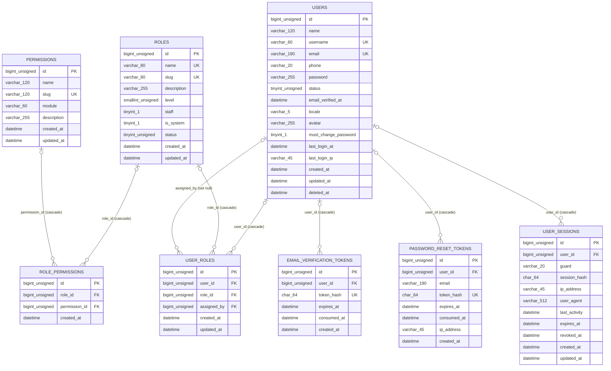

# Database design and entity-relationship diagram

<!-- Generated by scripts/maintenance/render_erd.php - do not edit by hand. -->

Source of truth: the schema named `dexxoxxbd_marketplace` as read back from `information_schema` on 2026-11-05. It describes what is installed, not what was intended.

Conventions that hold for all 50 tables:

- InnoDB, `utf8mb4`, `utf8mb4_unicode_ci`, `BIGINT UNSIGNED` surrogate keys with `AUTO_INCREMENT`.
- Money in `DECIMAL(12,2)`; never floats, never a currency column per line - one BDT shop, currency stored on the order.
- `created_at` / `updated_at` everywhere; `deleted_at` on catalogue, CMS and account records (soft delete).
- Every foreign key is declared with an index on the child column, so joins and cascades stay fast.
- Historical snapshots: `order_items` and `cart_items` copy the name, price and plan they were bought as.
- `stock = -1` means "not stock limited"; digital fulfilment is capped by the rows in `digital_inventory`.

| Metric | Count |
|---|---:|
| Tables | 50 |
| Columns | 598 |
| Indexes | 164 |
| Foreign keys | 75 |
| Full-text indexes | 1 |

## Domains

| Domain | Tables |
|---|---|
| Accounts, roles and sessions | `email_verification_tokens`, `password_reset_tokens`, `permissions`, `roles`, `role_permissions`, `users`, `user_roles`, `user_sessions` |
| Catalogue: categories, brands, products and variations | `brands`, `categories`, `products`, `product_faqs`, `product_features`, `product_images`, `product_related_items`, `product_variations` |
| Shopping: cart and wishlist | `carts`, `cart_items`, `wishlists`, `wishlist_items` |
| Orders, payments, delivery and subscriptions | `customer_subscriptions`, `digital_deliveries`, `digital_inventory`, `orders`, `order_items`, `order_status_history`, `payments`, `payment_transactions`, `subscription_events` |
| Promotions: coupons and their restrictions | `coupons`, `coupon_categories`, `coupon_products`, `coupon_usages` |
| Engagement: reviews, tickets, notifications, newsletter | `newsletter_subscribers`, `notifications`, `reviews`, `support_messages`, `support_tickets` |
| CMS: pages, FAQs, banners, testimonials, settings, menus | `banners`, `faqs`, `menus`, `pages`, `settings`, `testimonials` |
| System: audit, jobs, logs, idempotency | `audit_logs`, `background_jobs`, `failed_jobs`, `idempotency_keys`, `login_attempts`, `system_logs` |

## Accounts, roles and sessions

| Table | Purpose |
|---|---|
| `email_verification_tokens` | Hashed email-verification tokens; the raw token never lands in MySQL. |
| `password_reset_tokens` | Single-use hashed password-reset tokens. |
| `permissions` | Individual abilities checked server-side, grouped by module. |
| `roles` | RBAC roles; level 1 is the most privileged. |
| `role_permissions` | Permissions granted to each role. |
| `users` | Customer and staff accounts. |
| `user_roles` | Role assignments (a user may hold several roles). |
| `user_sessions` | Ledger of live sessions so a customer can revoke devices. |



## Catalogue: categories, brands, products and variations

| Table | Purpose |
|---|---|
| `brands` | Service brands (AI, streaming, VPN vendors and so on). |
| `categories` | Two-level category tree for the storefront. |
| `products` | Sellable subscriptions; pricing lives on product_variations. |
| `product_faqs` | Per-product questions and answers. |
| `product_features` | Bullet-point feature list shown on the product page. |
| `product_images` | Gallery images per product. |
| `product_related_items` | Curated cross-sells; falls back to category/brand matches. |
| `product_variations` | One plan per row: SKU, price, duration, stock and delivery. |

```mermaid
erDiagram
    BRANDS {
        bigint_unsigned id PK
        varchar_120 name
        varchar_140 slug UK
        varchar_255 logo
        text description
        varchar_255 website
        varchar_60 country
        int_unsigned sort_order
        tinyint_unsigned status
        datetime created_at
        datetime updated_at
        datetime deleted_at
    }
    CATEGORIES {
        bigint_unsigned id PK
        bigint_unsigned parent_id FK
        varchar_120 name
        varchar_140 slug UK
        text description
        varchar_255 image
        varchar_60 icon
        varchar_20 color
        int_unsigned sort_order
        tinyint_1 is_featured
        tinyint_unsigned status
        varchar_190 meta_title
        varchar_500 meta_description
        datetime created_at
        datetime updated_at
        datetime deleted_at
    }
    PRODUCTS {
        bigint_unsigned id PK
        bigint_unsigned category_id FK
        bigint_unsigned brand_id FK
        varchar_190 name
        varchar_200 slug UK
        varchar_500 short_description
        text description
        varchar_255 image
        varchar_50 badge
        varchar_60 account_type
        varchar_30 delivery_method
        varchar_255 warranty_info
        text support_info
        text activation_instructions
        tinyint_1 is_featured
        tinyint_1 is_bestseller
        tinyint_1 is_new_arrival
        enum_'draft'_'published'_'archived' status
        int_unsigned sort_order
        int_unsigned view_count
        int_unsigned sales_count
        decimal_3_2 rating_avg
        int_unsigned rating_count
        varchar_190 meta_title
        varchar_500 meta_description
        datetime created_at
        datetime updated_at
        datetime deleted_at
    }
    PRODUCT_FAQS {
        bigint_unsigned id PK
        bigint_unsigned product_id FK
        varchar_255 question
        text answer
        int_unsigned sort_order
        tinyint_unsigned status
        datetime created_at
        datetime updated_at
    }
    PRODUCT_FEATURES {
        bigint_unsigned id PK
        bigint_unsigned product_id FK
        varchar_190 label
        varchar_60 icon
        int_unsigned sort_order
        datetime created_at
        datetime updated_at
    }
    PRODUCT_IMAGES {
        bigint_unsigned id PK
        bigint_unsigned product_id FK
        varchar_255 path
        varchar_190 alt
        tinyint_1 is_primary
        int_unsigned sort_order
        datetime created_at
        datetime updated_at
    }
    PRODUCT_RELATED_ITEMS {
        bigint_unsigned id PK
        bigint_unsigned product_id FK
        bigint_unsigned related_product_id FK
        int_unsigned sort_order
        datetime created_at
    }
    PRODUCT_VARIATIONS {
        bigint_unsigned id PK
        bigint_unsigned product_id FK
        varchar_120 label
        varchar_80 sku UK
        decimal_12_2 price
        decimal_12_2 compare_price
        decimal_12_2 cost_price
        int_unsigned duration_days
        varchar_60 duration_label
        smallint_unsigned device_limit
        varchar_60 account_type
        enum_'auto_key'_'auto_code'_'manual'_'account_transfer' delivery_method
        int_11 stock
        smallint_unsigned min_quantity
        smallint_unsigned max_quantity
        smallint_unsigned warranty_days
        text notes
        int_unsigned sort_order
        int_unsigned sales_count
        tinyint_unsigned status
        datetime created_at
        datetime updated_at
        datetime deleted_at
    }
    CATEGORIES |o--o{ CATEGORIES : "parent_id (set null)"
    BRANDS |o--o{ PRODUCTS : "brand_id (set null)"
    CATEGORIES |o--o{ PRODUCTS : "category_id (restrict)"
    PRODUCTS |o--o{ PRODUCT_FAQS : "product_id (cascade)"
    PRODUCTS |o--o{ PRODUCT_FEATURES : "product_id (cascade)"
    PRODUCTS |o--o{ PRODUCT_IMAGES : "product_id (cascade)"
    PRODUCTS |o--o{ PRODUCT_RELATED_ITEMS : "product_id (cascade)"
    PRODUCTS |o--o{ PRODUCT_RELATED_ITEMS : "related_product_id (cascade)"
    PRODUCTS |o--o{ PRODUCT_VARIATIONS : "product_id (cascade)"
```

## Shopping: cart and wishlist

| Table | Purpose |
|---|---|
| `carts` | One open cart per customer; guest carts are keyed by a random token. |
| `cart_items` | Cart lines with server-side priced snapshots. |
| `wishlists` | Saved-for-later lists (one default list per customer). |
| `wishlist_items` | Products saved by a customer. |

```mermaid
erDiagram
    CARTS {
        bigint_unsigned id PK
        bigint_unsigned user_id FK
        char_40 guest_token
        varchar_60 coupon_code
        datetime merged_at
        datetime created_at
        datetime updated_at
    }
    CART_ITEMS {
        bigint_unsigned id PK
        bigint_unsigned cart_id FK
        bigint_unsigned product_id FK
        bigint_unsigned variation_id FK
        int_unsigned quantity
        decimal_12_2 unit_price
        varchar_190 product_name
        varchar_120 variation_label
        varchar_80 sku
        datetime created_at
        datetime updated_at
    }
    WISHLISTS {
        bigint_unsigned id PK
        bigint_unsigned user_id FK
        varchar_80 name UK
        tinyint_1 is_public
        datetime created_at
        datetime updated_at
    }
    WISHLIST_ITEMS {
        bigint_unsigned id PK
        bigint_unsigned wishlist_id FK
        bigint_unsigned product_id FK
        varchar_255 note
        datetime created_at
    }
    USERS {
        bigint_unsigned id PK
        varchar_120 name
        varchar_60 username UK
        varchar_190 email UK
        varchar_20 phone
        varchar_255 password
        tinyint_unsigned status
        datetime email_verified_at
        varchar_5 locale
        varchar_255 avatar
        tinyint_1 must_change_password
        datetime last_login_at
        varchar_45 last_login_ip
        datetime created_at
        datetime updated_at
        datetime deleted_at
    }
    PRODUCTS {
        bigint_unsigned id PK
        bigint_unsigned category_id FK
        bigint_unsigned brand_id FK
        varchar_190 name
        varchar_200 slug UK
        varchar_500 short_description
        text description
        varchar_255 image
        varchar_50 badge
        varchar_60 account_type
        varchar_30 delivery_method
        varchar_255 warranty_info
        text support_info
        text activation_instructions
        tinyint_1 is_featured
        tinyint_1 is_bestseller
        tinyint_1 is_new_arrival
        enum_'draft'_'published'_'archived' status
        int_unsigned sort_order
        int_unsigned view_count
        int_unsigned sales_count
        decimal_3_2 rating_avg
        int_unsigned rating_count
        varchar_190 meta_title
        varchar_500 meta_description
        datetime created_at
        datetime updated_at
        datetime deleted_at
    }
    PRODUCT_VARIATIONS {
        bigint_unsigned id PK
        bigint_unsigned product_id FK
        varchar_120 label
        varchar_80 sku UK
        decimal_12_2 price
        decimal_12_2 compare_price
        decimal_12_2 cost_price
        int_unsigned duration_days
        varchar_60 duration_label
        smallint_unsigned device_limit
        varchar_60 account_type
        enum_'auto_key'_'auto_code'_'manual'_'account_transfer' delivery_method
        int_11 stock
        smallint_unsigned min_quantity
        smallint_unsigned max_quantity
        smallint_unsigned warranty_days
        text notes
        int_unsigned sort_order
        int_unsigned sales_count
        tinyint_unsigned status
        datetime created_at
        datetime updated_at
        datetime deleted_at
    }
    USERS |o--o{ CARTS : "user_id (cascade)"
    CARTS |o--o{ CART_ITEMS : "cart_id (cascade)"
    PRODUCTS |o--o{ CART_ITEMS : "product_id (cascade)"
    PRODUCT_VARIATIONS |o--o{ CART_ITEMS : "variation_id (cascade)"
    USERS |o--o{ WISHLISTS : "user_id (cascade)"
    WISHLISTS |o--o{ WISHLIST_ITEMS : "wishlist_id (cascade)"
    PRODUCTS |o--o{ WISHLIST_ITEMS : "product_id (cascade)"
```

## Orders, payments, delivery and subscriptions

| Table | Purpose |
|---|---|
| `customer_subscriptions` | Active and expired entitlements shown in the customer dashboard. |
| `digital_deliveries` | Delivery of one inventory item against one order line. |
| `digital_inventory` | Encrypted license keys and credentials (AES-256-GCM ciphertext only). |
| `orders` | Customer orders with server-side totals and status timeline. |
| `order_items` | Immutable purchase snapshot: name, plan, SKU and price at purchase time. |
| `order_status_history` | Every status transition, including staff notes. |
| `payments` | Payment attempts per order; card data is never stored. |
| `payment_transactions` | Append-only gateway event log used to block duplicate callbacks. |
| `subscription_events` | Activation, renewal and expiry trail per subscription. |

```mermaid
erDiagram
    CUSTOMER_SUBSCRIPTIONS {
        bigint_unsigned id PK
        bigint_unsigned user_id FK
        bigint_unsigned order_id FK
        bigint_unsigned order_item_id FK
        bigint_unsigned product_id FK
        bigint_unsigned variation_id FK
        enum_'pending'_'active'_'expired'_'cancelled'_'suspended' status
        datetime starts_at
        datetime expires_at
        datetime activated_at
        datetime reminder_sent_at
        tinyint_1 auto_renew
        smallint_unsigned device_limit
        text notes
        datetime created_at
        datetime updated_at
    }
    DIGITAL_DELIVERIES {
        bigint_unsigned id PK
        bigint_unsigned order_id FK
        bigint_unsigned order_item_id FK
        bigint_unsigned digital_inventory_id FK
        bigint_unsigned user_id FK
        varchar_30 method
        enum_'pending'_'delivered'_'failed'_'revoked' status
        datetime delivered_at
        datetime emailed_at
        datetime viewed_at
        int_unsigned view_count
        smallint_unsigned attempts
        varchar_500 note
        datetime created_at
        datetime updated_at
    }
    DIGITAL_INVENTORY {
        bigint_unsigned id PK
        bigint_unsigned product_id FK
        bigint_unsigned variation_id FK
        enum_'license_key'_'code'_'credential'_'account' type
        text encrypted_payload
        varchar_44 encryption_iv
        varchar_44 auth_tag
        smallint_unsigned key_version
        char_64 dedupe_hash UK
        varchar_12 code_hint
        enum_'available'_'reserved'_'assigned'_'delivered'_'expired'_'revoked'_'invalid' status
        bigint_unsigned order_id FK
        bigint_unsigned order_item_id FK
        bigint_unsigned assigned_to FK
        datetime assigned_at
        datetime delivered_at
        datetime expires_at
        varchar_60 import_batch
        datetime created_at
        datetime updated_at
    }
    ORDERS {
        bigint_unsigned id PK
        varchar_32 order_number UK
        bigint_unsigned user_id FK
        enum_'pending'_'awaiting_payment'_'processing'_'paid'_'delivered'_'completed'_'cancelled'_'refunded'_'failed' status
        decimal_12_2 subtotal
        decimal_12_2 discount
        varchar_60 coupon_code
        decimal_12_2 total
        decimal_12_2 grand_total
        decimal_12_2 refunded_amount
        varchar_3 currency
        varchar_40 payment_method
        enum_'unpaid'_'pending'_'paid'_'failed'_'cancelled'_'refunded'_'partially_refunded' payment_status
        varchar_120 payment_reference
        varchar_120 customer_name
        varchar_190 customer_email
        varchar_20 customer_phone
        varchar_255 billing_address
        varchar_80 billing_city
        text notes
        text internal_notes
        datetime expires_at
        datetime paid_at
        datetime delivered_at
        datetime cancelled_at
        varchar_255 cancel_reason
        datetime refunded_at
        varchar_45 ip_address
        varchar_512 user_agent
        datetime created_at
        datetime updated_at
        datetime deleted_at
    }
    ORDER_ITEMS {
        bigint_unsigned id PK
        bigint_unsigned order_id FK
        bigint_unsigned product_id FK
        bigint_unsigned variation_id FK
        varchar_190 product_name
        varchar_120 variation_label
        varchar_80 sku
        decimal_12_2 unit_price
        int_unsigned quantity
        decimal_12_2 discount
        decimal_12_2 line_total
        int_unsigned duration_days
        varchar_30 delivery_method
        varchar_255 warranty_info
        longtext details
        datetime created_at
        datetime updated_at
    }
    ORDER_STATUS_HISTORY {
        bigint_unsigned id PK
        bigint_unsigned order_id FK
        bigint_unsigned user_id FK
        varchar_30 from_status
        varchar_30 to_status
        varchar_500 note
        tinyint_1 is_customer_visible
        datetime created_at
    }
    PAYMENTS {
        bigint_unsigned id PK
        bigint_unsigned order_id FK
        varchar_40 method
        varchar_40 gateway
        enum_'pending'_'completed'_'failed'_'cancelled'_'refunded' status
        decimal_12_2 amount
        varchar_3 currency
        varchar_120 transaction_reference
        varchar_190 gateway_payment_id
        varchar_190 gateway_track_id
        varchar_60 customer_account_hint
        longtext request_payload
        longtext response_payload
        varchar_500 failure_reason
        datetime verified_at
        bigint_unsigned verified_by FK
        datetime completed_at
        datetime created_at
        datetime updated_at
    }
    PAYMENT_TRANSACTIONS {
        bigint_unsigned id PK
        bigint_unsigned payment_id FK
        bigint_unsigned order_id FK
        varchar_60 event
        varchar_30 status
        decimal_12_2 amount
        varchar_3 currency
        varchar_190 reference
        varchar_190 idempotency_key UK
        tinyint_unsigned signature_valid
        varchar_45 source_ip
        longtext raw_payload
        datetime created_at
    }
    SUBSCRIPTION_EVENTS {
        bigint_unsigned id PK
        bigint_unsigned subscription_id FK
        bigint_unsigned user_id FK
        varchar_60 event
        varchar_30 from_status
        varchar_30 to_status
        varchar_500 note
        datetime created_at
    }
    PRODUCTS {
        bigint_unsigned id PK
        bigint_unsigned category_id FK
        bigint_unsigned brand_id FK
        varchar_190 name
        varchar_200 slug UK
        varchar_500 short_description
        text description
        varchar_255 image
        varchar_50 badge
        varchar_60 account_type
        varchar_30 delivery_method
        varchar_255 warranty_info
        text support_info
        text activation_instructions
        tinyint_1 is_featured
        tinyint_1 is_bestseller
        tinyint_1 is_new_arrival
        enum_'draft'_'published'_'archived' status
        int_unsigned sort_order
        int_unsigned view_count
        int_unsigned sales_count
        decimal_3_2 rating_avg
        int_unsigned rating_count
        varchar_190 meta_title
        varchar_500 meta_description
        datetime created_at
        datetime updated_at
        datetime deleted_at
    }
    USERS {
        bigint_unsigned id PK
        varchar_120 name
        varchar_60 username UK
        varchar_190 email UK
        varchar_20 phone
        varchar_255 password
        tinyint_unsigned status
        datetime email_verified_at
        varchar_5 locale
        varchar_255 avatar
        tinyint_1 must_change_password
        datetime last_login_at
        varchar_45 last_login_ip
        datetime created_at
        datetime updated_at
        datetime deleted_at
    }
    PRODUCT_VARIATIONS {
        bigint_unsigned id PK
        bigint_unsigned product_id FK
        varchar_120 label
        varchar_80 sku UK
        decimal_12_2 price
        decimal_12_2 compare_price
        decimal_12_2 cost_price
        int_unsigned duration_days
        varchar_60 duration_label
        smallint_unsigned device_limit
        varchar_60 account_type
        enum_'auto_key'_'auto_code'_'manual'_'account_transfer' delivery_method
        int_11 stock
        smallint_unsigned min_quantity
        smallint_unsigned max_quantity
        smallint_unsigned warranty_days
        text notes
        int_unsigned sort_order
        int_unsigned sales_count
        tinyint_unsigned status
        datetime created_at
        datetime updated_at
        datetime deleted_at
    }
    ORDERS |o--o{ CUSTOMER_SUBSCRIPTIONS : "order_id (set null)"
    ORDER_ITEMS |o--o{ CUSTOMER_SUBSCRIPTIONS : "order_item_id (set null)"
    PRODUCTS |o--o{ CUSTOMER_SUBSCRIPTIONS : "product_id (cascade)"
    USERS |o--o{ CUSTOMER_SUBSCRIPTIONS : "user_id (cascade)"
    PRODUCT_VARIATIONS |o--o{ CUSTOMER_SUBSCRIPTIONS : "variation_id (cascade)"
    DIGITAL_INVENTORY |o--o{ DIGITAL_DELIVERIES : "digital_inventory_id (set null)"
    ORDERS |o--o{ DIGITAL_DELIVERIES : "order_id (cascade)"
    ORDER_ITEMS |o--o{ DIGITAL_DELIVERIES : "order_item_id (cascade)"
    USERS |o--o{ DIGITAL_DELIVERIES : "user_id (set null)"
    USERS |o--o{ DIGITAL_INVENTORY : "assigned_to (set null)"
    ORDERS |o--o{ DIGITAL_INVENTORY : "order_id (set null)"
    ORDER_ITEMS |o--o{ DIGITAL_INVENTORY : "order_item_id (set null)"
    PRODUCTS |o--o{ DIGITAL_INVENTORY : "product_id (cascade)"
    PRODUCT_VARIATIONS |o--o{ DIGITAL_INVENTORY : "variation_id (cascade)"
    USERS |o--o{ ORDERS : "user_id (set null)"
    ORDERS |o--o{ ORDER_ITEMS : "order_id (cascade)"
    PRODUCTS |o--o{ ORDER_ITEMS : "product_id (set null)"
    PRODUCT_VARIATIONS |o--o{ ORDER_ITEMS : "variation_id (set null)"
    ORDERS |o--o{ ORDER_STATUS_HISTORY : "order_id (cascade)"
    USERS |o--o{ ORDER_STATUS_HISTORY : "user_id (set null)"
    ORDERS |o--o{ PAYMENTS : "order_id (cascade)"
    USERS |o--o{ PAYMENTS : "verified_by (set null)"
    ORDERS |o--o{ PAYMENT_TRANSACTIONS : "order_id (cascade)"
    PAYMENTS |o--o{ PAYMENT_TRANSACTIONS : "payment_id (cascade)"
    CUSTOMER_SUBSCRIPTIONS |o--o{ SUBSCRIPTION_EVENTS : "subscription_id (cascade)"
    USERS |o--o{ SUBSCRIPTION_EVENTS : "user_id (set null)"
```

## Promotions: coupons and their restrictions

| Table | Purpose |
|---|---|
| `coupons` | Percentage or fixed-amount discount codes. |
| `coupon_categories` | Categories a coupon is restricted to. |
| `coupon_products` | Products a coupon is restricted to. |
| `coupon_usages` | One row per redeemed coupon, the basis for usage limits. |

```mermaid
erDiagram
    COUPONS {
        bigint_unsigned id PK
        varchar_60 code UK
        varchar_120 name
        varchar_500 description
        enum_'percent'_'fixed' type
        decimal_12_2 value
        decimal_12_2 min_order_amount
        decimal_12_2 max_discount
        enum_'all'_'products'_'categories' restriction_mode
        int_unsigned usage_limit
        smallint_unsigned usage_limit_per_user
        int_unsigned usage_count
        tinyint_1 first_order_only
        tinyint_1 auto_apply
        tinyint_1 stackable
        datetime starts_at
        datetime expires_at
        tinyint_unsigned status
        bigint_unsigned created_by FK
        datetime created_at
        datetime updated_at
        datetime deleted_at
    }
    COUPON_CATEGORIES {
        bigint_unsigned id PK
        bigint_unsigned coupon_id FK
        bigint_unsigned category_id FK
        datetime created_at
    }
    COUPON_PRODUCTS {
        bigint_unsigned id PK
        bigint_unsigned coupon_id FK
        bigint_unsigned product_id FK
        datetime created_at
    }
    COUPON_USAGES {
        bigint_unsigned id PK
        bigint_unsigned coupon_id FK
        bigint_unsigned order_id FK
        bigint_unsigned user_id FK
        bigint_unsigned cart_id FK
        decimal_12_2 discount_amount
        datetime used_at
        datetime created_at
    }
    USERS {
        bigint_unsigned id PK
        varchar_120 name
        varchar_60 username UK
        varchar_190 email UK
        varchar_20 phone
        varchar_255 password
        tinyint_unsigned status
        datetime email_verified_at
        varchar_5 locale
        varchar_255 avatar
        tinyint_1 must_change_password
        datetime last_login_at
        varchar_45 last_login_ip
        datetime created_at
        datetime updated_at
        datetime deleted_at
    }
    CATEGORIES {
        bigint_unsigned id PK
        bigint_unsigned parent_id FK
        varchar_120 name
        varchar_140 slug UK
        text description
        varchar_255 image
        varchar_60 icon
        varchar_20 color
        int_unsigned sort_order
        tinyint_1 is_featured
        tinyint_unsigned status
        varchar_190 meta_title
        varchar_500 meta_description
        datetime created_at
        datetime updated_at
        datetime deleted_at
    }
    PRODUCTS {
        bigint_unsigned id PK
        bigint_unsigned category_id FK
        bigint_unsigned brand_id FK
        varchar_190 name
        varchar_200 slug UK
        varchar_500 short_description
        text description
        varchar_255 image
        varchar_50 badge
        varchar_60 account_type
        varchar_30 delivery_method
        varchar_255 warranty_info
        text support_info
        text activation_instructions
        tinyint_1 is_featured
        tinyint_1 is_bestseller
        tinyint_1 is_new_arrival
        enum_'draft'_'published'_'archived' status
        int_unsigned sort_order
        int_unsigned view_count
        int_unsigned sales_count
        decimal_3_2 rating_avg
        int_unsigned rating_count
        varchar_190 meta_title
        varchar_500 meta_description
        datetime created_at
        datetime updated_at
        datetime deleted_at
    }
    CARTS {
        bigint_unsigned id PK
        bigint_unsigned user_id FK
        char_40 guest_token
        varchar_60 coupon_code
        datetime merged_at
        datetime created_at
        datetime updated_at
    }
    ORDERS {
        bigint_unsigned id PK
        varchar_32 order_number UK
        bigint_unsigned user_id FK
        enum_'pending'_'awaiting_payment'_'processing'_'paid'_'delivered'_'completed'_'cancelled'_'refunded'_'failed' status
        decimal_12_2 subtotal
        decimal_12_2 discount
        varchar_60 coupon_code
        decimal_12_2 total
        decimal_12_2 grand_total
        decimal_12_2 refunded_amount
        varchar_3 currency
        varchar_40 payment_method
        enum_'unpaid'_'pending'_'paid'_'failed'_'cancelled'_'refunded'_'partially_refunded' payment_status
        varchar_120 payment_reference
        varchar_120 customer_name
        varchar_190 customer_email
        varchar_20 customer_phone
        varchar_255 billing_address
        varchar_80 billing_city
        text notes
        text internal_notes
        datetime expires_at
        datetime paid_at
        datetime delivered_at
        datetime cancelled_at
        varchar_255 cancel_reason
        datetime refunded_at
        varchar_45 ip_address
        varchar_512 user_agent
        datetime created_at
        datetime updated_at
        datetime deleted_at
    }
    USERS |o--o{ COUPONS : "created_by (set null)"
    CATEGORIES |o--o{ COUPON_CATEGORIES : "category_id (cascade)"
    COUPONS |o--o{ COUPON_CATEGORIES : "coupon_id (cascade)"
    COUPONS |o--o{ COUPON_PRODUCTS : "coupon_id (cascade)"
    PRODUCTS |o--o{ COUPON_PRODUCTS : "product_id (cascade)"
    CARTS |o--o{ COUPON_USAGES : "cart_id (set null)"
    COUPONS |o--o{ COUPON_USAGES : "coupon_id (cascade)"
    ORDERS |o--o{ COUPON_USAGES : "order_id (set null)"
    USERS |o--o{ COUPON_USAGES : "user_id (set null)"
```

## Engagement: reviews, tickets, notifications, newsletter

| Table | Purpose |
|---|---|
| `newsletter_subscribers` | Double opt-in newsletter list. |
| `notifications` | In-app notification inbox. |
| `reviews` | Moderated product reviews; ratings are rolled up onto products. |
| `support_messages` | Replies inside a ticket, from customer or staff. |
| `support_tickets` | Customer support conversations. |

```mermaid
erDiagram
    NEWSLETTER_SUBSCRIBERS {
        bigint_unsigned id PK
        varchar_190 email UK
        varchar_120 name
        varchar_5 locale
        enum_'pending'_'subscribed'_'unsubscribed' status
        char_64 token_hash
        datetime subscribed_at
        datetime unsubscribed_at
        varchar_45 ip_address
        datetime created_at
        datetime updated_at
    }
    NOTIFICATIONS {
        bigint_unsigned id PK
        bigint_unsigned user_id FK
        varchar_60 type
        varchar_190 title
        text message
        varchar_255 link
        varchar_60 icon
        tinyint_1 is_read
        datetime read_at
        datetime created_at
        datetime updated_at
    }
    REVIEWS {
        bigint_unsigned id PK
        bigint_unsigned product_id FK
        bigint_unsigned user_id FK
        bigint_unsigned order_id FK
        varchar_120 author_name
        tinyint_unsigned rating
        varchar_190 title
        text body
        enum_'pending'_'approved'_'rejected' status
        tinyint_1 is_verified_purchase
        int_unsigned helpful_count
        text owner_response
        datetime responded_at
        datetime created_at
        datetime updated_at
        datetime deleted_at
    }
    SUPPORT_MESSAGES {
        bigint_unsigned id PK
        bigint_unsigned ticket_id FK
        bigint_unsigned user_id FK
        tinyint_1 is_staff
        text body
        varchar_255 attachment
        datetime created_at
        datetime updated_at
    }
    SUPPORT_TICKETS {
        bigint_unsigned id PK
        varchar_24 ticket_number UK
        bigint_unsigned user_id FK
        bigint_unsigned order_id FK
        enum_'general'_'order'_'payment'_'delivery'_'technical' department
        varchar_190 subject
        text body
        enum_'low'_'normal'_'high'_'urgent' priority
        enum_'open'_'answered'_'customer_reply'_'in_progress'_'resolved'_'closed' status
        bigint_unsigned assigned_to FK
        datetime last_reply_at
        datetime closed_at
        datetime created_at
        datetime updated_at
        datetime deleted_at
    }
    USERS {
        bigint_unsigned id PK
        varchar_120 name
        varchar_60 username UK
        varchar_190 email UK
        varchar_20 phone
        varchar_255 password
        tinyint_unsigned status
        datetime email_verified_at
        varchar_5 locale
        varchar_255 avatar
        tinyint_1 must_change_password
        datetime last_login_at
        varchar_45 last_login_ip
        datetime created_at
        datetime updated_at
        datetime deleted_at
    }
    ORDERS {
        bigint_unsigned id PK
        varchar_32 order_number UK
        bigint_unsigned user_id FK
        enum_'pending'_'awaiting_payment'_'processing'_'paid'_'delivered'_'completed'_'cancelled'_'refunded'_'failed' status
        decimal_12_2 subtotal
        decimal_12_2 discount
        varchar_60 coupon_code
        decimal_12_2 total
        decimal_12_2 grand_total
        decimal_12_2 refunded_amount
        varchar_3 currency
        varchar_40 payment_method
        enum_'unpaid'_'pending'_'paid'_'failed'_'cancelled'_'refunded'_'partially_refunded' payment_status
        varchar_120 payment_reference
        varchar_120 customer_name
        varchar_190 customer_email
        varchar_20 customer_phone
        varchar_255 billing_address
        varchar_80 billing_city
        text notes
        text internal_notes
        datetime expires_at
        datetime paid_at
        datetime delivered_at
        datetime cancelled_at
        varchar_255 cancel_reason
        datetime refunded_at
        varchar_45 ip_address
        varchar_512 user_agent
        datetime created_at
        datetime updated_at
        datetime deleted_at
    }
    PRODUCTS {
        bigint_unsigned id PK
        bigint_unsigned category_id FK
        bigint_unsigned brand_id FK
        varchar_190 name
        varchar_200 slug UK
        varchar_500 short_description
        text description
        varchar_255 image
        varchar_50 badge
        varchar_60 account_type
        varchar_30 delivery_method
        varchar_255 warranty_info
        text support_info
        text activation_instructions
        tinyint_1 is_featured
        tinyint_1 is_bestseller
        tinyint_1 is_new_arrival
        enum_'draft'_'published'_'archived' status
        int_unsigned sort_order
        int_unsigned view_count
        int_unsigned sales_count
        decimal_3_2 rating_avg
        int_unsigned rating_count
        varchar_190 meta_title
        varchar_500 meta_description
        datetime created_at
        datetime updated_at
        datetime deleted_at
    }
    USERS |o--o{ NOTIFICATIONS : "user_id (cascade)"
    ORDERS |o--o{ REVIEWS : "order_id (set null)"
    PRODUCTS |o--o{ REVIEWS : "product_id (cascade)"
    USERS |o--o{ REVIEWS : "user_id (set null)"
    SUPPORT_TICKETS |o--o{ SUPPORT_MESSAGES : "ticket_id (cascade)"
    USERS |o--o{ SUPPORT_MESSAGES : "user_id (set null)"
    USERS |o--o{ SUPPORT_TICKETS : "assigned_to (set null)"
    ORDERS |o--o{ SUPPORT_TICKETS : "order_id (set null)"
    USERS |o--o{ SUPPORT_TICKETS : "user_id (cascade)"
```

## CMS: pages, FAQs, banners, testimonials, settings, menus

| Table | Purpose |
|---|---|
| `banners` | Hero, promotional and announcement banners by placement. |
| `faqs` | Site-wide frequently asked questions. |
| `menus` | Header, mobile and footer navigation items. |
| `pages` | Static content pages (about, terms, privacy, delivery, refund). |
| `settings` | Key/value website settings grouped for the admin CMS screen. |
| `testimonials` | Curated customer testimonials for the homepage. |

```mermaid
erDiagram
    BANNERS {
        bigint_unsigned id PK
        enum_'announcement'_'home_hero'_'home_promo'_'category'_'sidebar' placement
        varchar_190 title
        varchar_255 subtitle
        text description
        varchar_60 badge
        varchar_255 image
        varchar_190 image_alt
        varchar_255 link
        varchar_60 button_text
        varchar_30 button_style
        datetime starts_at
        datetime ends_at
        int_unsigned sort_order
        tinyint_unsigned status
        varchar_5 locale
        datetime created_at
        datetime updated_at
    }
    FAQS {
        bigint_unsigned id PK
        varchar_255 question
        text answer
        varchar_80 category
        int_unsigned sort_order
        tinyint_1 show_on_home
        tinyint_unsigned status
        varchar_5 locale
        datetime created_at
        datetime updated_at
    }
    MENUS {
        bigint_unsigned id PK
        enum_'header'_'mobile'_'footer' location
        bigint_unsigned parent_id FK
        varchar_120 label
        enum_'url'_'page'_'category'_'product' target_type
        bigint_unsigned target_id
        varchar_255 url
        varchar_60 icon
        tinyint_1 open_in_new_tab
        int_unsigned sort_order
        tinyint_unsigned status
        datetime created_at
        datetime updated_at
    }
    PAGES {
        bigint_unsigned id PK
        varchar_190 title
        varchar_200 slug UK
        varchar_500 excerpt
        text content
        varchar_60 template
        varchar_190 meta_title
        varchar_500 meta_description
        enum_'draft'_'published' status
        tinyint_1 is_footer
        int_unsigned sort_order
        varchar_5 locale UK
        datetime created_at
        datetime updated_at
        datetime deleted_at
    }
    SETTINGS {
        bigint_unsigned id PK
        varchar_140 key UK
        text value
        enum_'string'_'text'_'number'_'boolean'_'json'_'image'_'color' type
        varchar_60 group_name
        varchar_190 label
        varchar_255 description
        tinyint_1 is_public
        int_unsigned sort_order
        datetime created_at
        datetime updated_at
    }
    TESTIMONIALS {
        bigint_unsigned id PK
        varchar_120 customer_name
        varchar_120 customer_title
        varchar_120 customer_location
        text quote
        tinyint_unsigned rating
        varchar_255 avatar
        bigint_unsigned product_id FK
        bigint_unsigned user_id FK
        tinyint_unsigned status
        int_unsigned sort_order
        varchar_5 locale
        datetime created_at
        datetime updated_at
    }
    PRODUCTS {
        bigint_unsigned id PK
        bigint_unsigned category_id FK
        bigint_unsigned brand_id FK
        varchar_190 name
        varchar_200 slug UK
        varchar_500 short_description
        text description
        varchar_255 image
        varchar_50 badge
        varchar_60 account_type
        varchar_30 delivery_method
        varchar_255 warranty_info
        text support_info
        text activation_instructions
        tinyint_1 is_featured
        tinyint_1 is_bestseller
        tinyint_1 is_new_arrival
        enum_'draft'_'published'_'archived' status
        int_unsigned sort_order
        int_unsigned view_count
        int_unsigned sales_count
        decimal_3_2 rating_avg
        int_unsigned rating_count
        varchar_190 meta_title
        varchar_500 meta_description
        datetime created_at
        datetime updated_at
        datetime deleted_at
    }
    USERS {
        bigint_unsigned id PK
        varchar_120 name
        varchar_60 username UK
        varchar_190 email UK
        varchar_20 phone
        varchar_255 password
        tinyint_unsigned status
        datetime email_verified_at
        varchar_5 locale
        varchar_255 avatar
        tinyint_1 must_change_password
        datetime last_login_at
        varchar_45 last_login_ip
        datetime created_at
        datetime updated_at
        datetime deleted_at
    }
    MENUS |o--o{ MENUS : "parent_id (set null)"
    PRODUCTS |o--o{ TESTIMONIALS : "product_id (set null)"
    USERS |o--o{ TESTIMONIALS : "user_id (set null)"
```

## System: audit, jobs, logs, idempotency

| Table | Purpose |
|---|---|
| `audit_logs` | Append-only record of privileged actions. |
| `background_jobs` | Database-backed job queue drained by scripts/cron/worker.php. |
| `failed_jobs` | Jobs that exhausted their retries, kept for inspection and replay. |
| `idempotency_keys` | Replay protection for checkout, webhooks and job dispatch. |
| `login_attempts` | Hashed-identifier login throttle log; raw emails are never stored. |
| `system_logs` | Database mirror of the log stream for the admin log viewer. |

```mermaid
erDiagram
    AUDIT_LOGS {
        bigint_unsigned id PK
        bigint_unsigned user_id FK
        varchar_100 action
        varchar_500 description
        varchar_80 subject_type
        bigint_unsigned subject_id
        text old_values
        text new_values
        text context
        varchar_45 ip_address
        varchar_512 user_agent
        datetime created_at
    }
    BACKGROUND_JOBS {
        bigint_unsigned id PK
        varchar_40 queue
        varchar_120 job
        text payload
        tinyint_unsigned attempts
        datetime available_at
        datetime reserved_at
        datetime executed_at
        enum_'pending'_'processing'_'completed'_'failed'_'cancelled' status
        text last_error
        datetime created_at
        datetime updated_at
    }
    FAILED_JOBS {
        bigint_unsigned id PK
        bigint_unsigned job_id
        varchar_40 queue
        varchar_120 job
        text payload
        tinyint_unsigned attempts
        text exception
        datetime failed_at
        datetime created_at
    }
    IDEMPOTENCY_KEYS {
        bigint_unsigned id PK
        varchar_190 key UK
        varchar_80 scope UK
        bigint_unsigned user_id FK
        char_64 request_hash
        enum_'in_progress'_'completed'_'failed' status
        smallint_unsigned response_code
        text response_body
        varchar_60 resource_type
        bigint_unsigned resource_id
        datetime expires_at
        datetime created_at
        datetime updated_at
    }
    LOGIN_ATTEMPTS {
        bigint_unsigned id PK
        bigint_unsigned user_id FK
        char_64 identifier
        varchar_45 ip
        varchar_512 user_agent
        tinyint_1 successful
        datetime attempted_at
    }
    SYSTEM_LOGS {
        bigint_unsigned id PK
        varchar_16 level
        varchar_40 channel
        text message
        text context
        bigint_unsigned user_id FK
        varchar_45 ip_address
        datetime created_at
    }
    USERS {
        bigint_unsigned id PK
        varchar_120 name
        varchar_60 username UK
        varchar_190 email UK
        varchar_20 phone
        varchar_255 password
        tinyint_unsigned status
        datetime email_verified_at
        varchar_5 locale
        varchar_255 avatar
        tinyint_1 must_change_password
        datetime last_login_at
        varchar_45 last_login_ip
        datetime created_at
        datetime updated_at
        datetime deleted_at
    }
    USERS |o--o{ AUDIT_LOGS : "user_id (set null)"
    USERS |o--o{ IDEMPOTENCY_KEYS : "user_id (set null)"
    USERS |o--o{ LOGIN_ATTEMPTS : "user_id (cascade)"
    USERS |o--o{ SYSTEM_LOGS : "user_id (set null)"
```

## Column reference

### Accounts, roles and sessions

#### `email_verification_tokens`

Hashed email-verification tokens; the raw token never lands in MySQL.

| Column | Type | Null | Key | Default |
|---|---|---|---|---|
| `id` | bigint(20) unsigned | no | PRI | - _( auto_increment )_ |
| `user_id` | bigint(20) unsigned | yes | MUL | NULL |
| `token_hash` | char(64) | yes | UNI | NULL |
| `expires_at` | datetime | yes |  | NULL |
| `consumed_at` | datetime | yes |  | NULL |
| `created_at` | datetime | yes |  | current_timestamp() |

Indexes: UNIQUE email_tokens_hash_unique (token_hash); email_tokens_user_expiry_index (user_id, expires_at).

Foreign keys: (user_id) -> users(id) ON DELETE cascade.

#### `password_reset_tokens`

Single-use hashed password-reset tokens.

| Column | Type | Null | Key | Default |
|---|---|---|---|---|
| `id` | bigint(20) unsigned | no | PRI | - _( auto_increment )_ |
| `user_id` | bigint(20) unsigned | yes | MUL | NULL |
| `email` | varchar(190) | yes | MUL | NULL |
| `token_hash` | char(64) | yes | UNI | NULL |
| `expires_at` | datetime | yes |  | NULL |
| `consumed_at` | datetime | yes |  | NULL |
| `ip_address` | varchar(45) | yes |  | NULL |
| `created_at` | datetime | yes |  | current_timestamp() |

Indexes: password_tokens_email_index (email); UNIQUE password_tokens_hash_unique (token_hash); password_tokens_user_index (user_id).

Foreign keys: (user_id) -> users(id) ON DELETE cascade.

#### `permissions`

Individual abilities checked server-side, grouped by module.

| Column | Type | Null | Key | Default |
|---|---|---|---|---|
| `id` | bigint(20) unsigned | no | PRI | - _( auto_increment )_ |
| `name` | varchar(120) | yes |  | NULL |
| `slug` | varchar(120) | yes | UNI | NULL |
| `module` | varchar(60) | yes | MUL | NULL |
| `description` | varchar(255) | yes |  | NULL |
| `created_at` | datetime | yes |  | current_timestamp() |
| `updated_at` | datetime | yes |  | current_timestamp() _( on update current_timestamp() )_ |

Indexes: permissions_module_index (module); UNIQUE permissions_slug_unique (slug).

#### `roles`

RBAC roles; level 1 is the most privileged.

| Column | Type | Null | Key | Default |
|---|---|---|---|---|
| `id` | bigint(20) unsigned | no | PRI | - _( auto_increment )_ |
| `name` | varchar(80) | yes | UNI | NULL |
| `slug` | varchar(80) | yes | UNI | NULL |
| `description` | varchar(255) | yes |  | NULL |
| `level` | smallint(6) unsigned | yes | MUL | 100 |
| `staff` | tinyint(1) | yes | MUL | 0 |
| `is_system` | tinyint(1) | yes |  | 0 |
| `status` | tinyint(4) unsigned | yes |  | 1 |
| `created_at` | datetime | yes |  | current_timestamp() |
| `updated_at` | datetime | yes |  | current_timestamp() _( on update current_timestamp() )_ |

Indexes: roles_level_index (level); UNIQUE roles_name_unique (name); UNIQUE roles_slug_unique (slug); roles_staff_status_index (staff, status).

#### `role_permissions`

Permissions granted to each role.

| Column | Type | Null | Key | Default |
|---|---|---|---|---|
| `id` | bigint(20) unsigned | no | PRI | - _( auto_increment )_ |
| `role_id` | bigint(20) unsigned | yes | MUL | NULL |
| `permission_id` | bigint(20) unsigned | yes | MUL | NULL |
| `created_at` | datetime | yes |  | current_timestamp() |

Indexes: role_permissions_permission_index (permission_id); UNIQUE role_permissions_role_permission_unique (role_id, permission_id).

Foreign keys: (permission_id) -> permissions(id) ON DELETE cascade; (role_id) -> roles(id) ON DELETE cascade.

#### `users`

Customer and staff accounts.

| Column | Type | Null | Key | Default |
|---|---|---|---|---|
| `id` | bigint(20) unsigned | no | PRI | - _( auto_increment )_ |
| `name` | varchar(120) | yes |  | NULL |
| `username` | varchar(60) | yes | UNI | NULL |
| `email` | varchar(190) | yes | UNI | NULL |
| `phone` | varchar(20) | yes | MUL | NULL |
| `password` | varchar(255) | yes |  | NULL |
| `status` | tinyint(4) unsigned | yes | MUL | 2 |
| `email_verified_at` | datetime | yes |  | NULL |
| `locale` | varchar(5) | yes |  | 'en' |
| `avatar` | varchar(255) | yes |  | NULL |
| `must_change_password` | tinyint(1) | yes |  | 0 |
| `last_login_at` | datetime | yes |  | NULL |
| `last_login_ip` | varchar(45) | yes |  | NULL |
| `created_at` | datetime | yes | MUL | current_timestamp() |
| `updated_at` | datetime | yes |  | current_timestamp() _( on update current_timestamp() )_ |
| `deleted_at` | datetime | yes |  | NULL |

Indexes: users_created_at_index (created_at); UNIQUE users_email_unique (email); users_phone_index (phone); users_status_deleted_index (status, deleted_at); UNIQUE users_username_unique (username).

#### `user_roles`

Role assignments (a user may hold several roles).

| Column | Type | Null | Key | Default |
|---|---|---|---|---|
| `id` | bigint(20) unsigned | no | PRI | - _( auto_increment )_ |
| `user_id` | bigint(20) unsigned | yes | MUL | NULL |
| `role_id` | bigint(20) unsigned | yes | MUL | NULL |
| `assigned_by` | bigint(20) unsigned | yes | MUL | NULL |
| `created_at` | datetime | yes |  | current_timestamp() |
| `updated_at` | datetime | yes |  | current_timestamp() _( on update current_timestamp() )_ |

Indexes: fk_user_roles_assigner (assigned_by); user_roles_role_index (role_id); UNIQUE user_roles_user_role_unique (user_id, role_id).

Foreign keys: (assigned_by) -> users(id) ON DELETE set null; (role_id) -> roles(id) ON DELETE cascade; (user_id) -> users(id) ON DELETE cascade.

#### `user_sessions`

Ledger of live sessions so a customer can revoke devices.

| Column | Type | Null | Key | Default |
|---|---|---|---|---|
| `id` | bigint(20) unsigned | no | PRI | - _( auto_increment )_ |
| `user_id` | bigint(20) unsigned | yes | MUL | NULL |
| `guard` | varchar(20) | yes |  | 'web' |
| `session_hash` | char(64) | yes | MUL | NULL |
| `ip_address` | varchar(45) | yes |  | NULL |
| `user_agent` | varchar(512) | yes |  | NULL |
| `last_activity` | datetime | yes |  | NULL |
| `expires_at` | datetime | yes | MUL | NULL |
| `revoked_at` | datetime | yes |  | NULL |
| `created_at` | datetime | yes |  | current_timestamp() |
| `updated_at` | datetime | yes |  | current_timestamp() _( on update current_timestamp() )_ |

Indexes: user_sessions_expiry_index (expires_at); user_sessions_hash_index (session_hash); user_sessions_user_guard_index (user_id, guard, revoked_at).

Foreign keys: (user_id) -> users(id) ON DELETE cascade.

### Catalogue: categories, brands, products and variations

#### `brands`

Service brands (AI, streaming, VPN vendors and so on).

| Column | Type | Null | Key | Default |
|---|---|---|---|---|
| `id` | bigint(20) unsigned | no | PRI | - _( auto_increment )_ |
| `name` | varchar(120) | yes | MUL | NULL |
| `slug` | varchar(140) | yes | UNI | NULL |
| `logo` | varchar(255) | yes |  | NULL |
| `description` | text | yes |  | NULL |
| `website` | varchar(255) | yes |  | NULL |
| `country` | varchar(60) | yes |  | NULL |
| `sort_order` | int(11) unsigned | yes |  | 0 |
| `status` | tinyint(4) unsigned | yes | MUL | 1 |
| `created_at` | datetime | yes |  | current_timestamp() |
| `updated_at` | datetime | yes |  | current_timestamp() _( on update current_timestamp() )_ |
| `deleted_at` | datetime | yes |  | NULL |

Indexes: brands_name_index (name); UNIQUE brands_slug_unique (slug); brands_status_index (status).

#### `categories`

Two-level category tree for the storefront.

| Column | Type | Null | Key | Default |
|---|---|---|---|---|
| `id` | bigint(20) unsigned | no | PRI | - _( auto_increment )_ |
| `parent_id` | bigint(20) unsigned | yes | MUL | NULL |
| `name` | varchar(120) | yes |  | NULL |
| `slug` | varchar(140) | yes | UNI | NULL |
| `description` | text | yes |  | NULL |
| `image` | varchar(255) | yes |  | NULL |
| `icon` | varchar(60) | yes |  | NULL |
| `color` | varchar(20) | yes |  | NULL |
| `sort_order` | int(11) unsigned | yes |  | 0 |
| `is_featured` | tinyint(1) | yes |  | 0 |
| `status` | tinyint(4) unsigned | yes | MUL | 1 |
| `meta_title` | varchar(190) | yes |  | NULL |
| `meta_description` | varchar(500) | yes |  | NULL |
| `created_at` | datetime | yes |  | current_timestamp() |
| `updated_at` | datetime | yes |  | current_timestamp() _( on update current_timestamp() )_ |
| `deleted_at` | datetime | yes |  | NULL |

Indexes: categories_parent_index (parent_id); UNIQUE categories_slug_unique (slug); categories_status_sort_index (status, sort_order).

Foreign keys: (parent_id) -> categories(id) ON DELETE set null.

#### `products`

Sellable subscriptions; pricing lives on product_variations.

| Column | Type | Null | Key | Default |
|---|---|---|---|---|
| `id` | bigint(20) unsigned | no | PRI | - _( auto_increment )_ |
| `category_id` | bigint(20) unsigned | yes | MUL | NULL |
| `brand_id` | bigint(20) unsigned | yes | MUL | NULL |
| `name` | varchar(190) | yes | MUL | NULL |
| `slug` | varchar(200) | yes | UNI | NULL |
| `short_description` | varchar(500) | yes |  | NULL |
| `description` | text | yes |  | NULL |
| `image` | varchar(255) | yes |  | NULL |
| `badge` | varchar(50) | yes |  | NULL |
| `account_type` | varchar(60) | yes |  | NULL |
| `delivery_method` | varchar(30) | yes |  | 'manual' |
| `warranty_info` | varchar(255) | yes |  | NULL |
| `support_info` | text | yes |  | NULL |
| `activation_instructions` | text | yes |  | NULL |
| `is_featured` | tinyint(1) | yes | MUL | 0 |
| `is_bestseller` | tinyint(1) | yes | MUL | 0 |
| `is_new_arrival` | tinyint(1) | yes | MUL | 0 |
| `status` | enum('draft','published','archived') | yes | MUL | 'draft' |
| `sort_order` | int(11) unsigned | yes |  | 0 |
| `view_count` | int(11) unsigned | yes |  | 0 |
| `sales_count` | int(11) unsigned | yes | MUL | 0 |
| `rating_avg` | decimal(3,2) | yes | MUL | 0.00 |
| `rating_count` | int(11) unsigned | yes |  | 0 |
| `meta_title` | varchar(190) | yes |  | NULL |
| `meta_description` | varchar(500) | yes |  | NULL |
| `created_at` | datetime | yes | MUL | current_timestamp() |
| `updated_at` | datetime | yes |  | current_timestamp() _( on update current_timestamp() )_ |
| `deleted_at` | datetime | yes |  | NULL |

Indexes: products_bestseller_index (is_bestseller); products_brand_index (brand_id); products_category_index (category_id); products_created_index (created_at); products_featured_index (is_featured); products_new_arrival_index (is_new_arrival); products_rating_index (rating_avg, rating_count); products_sales_index (sales_count); products_search_fulltext (name, short_description) FULLTEXT; UNIQUE products_slug_unique (slug); products_status_deleted_index (status, deleted_at).

Foreign keys: (brand_id) -> brands(id) ON DELETE set null; (category_id) -> categories(id) ON DELETE restrict.

#### `product_faqs`

Per-product questions and answers.

| Column | Type | Null | Key | Default |
|---|---|---|---|---|
| `id` | bigint(20) unsigned | no | PRI | - _( auto_increment )_ |
| `product_id` | bigint(20) unsigned | yes | MUL | NULL |
| `question` | varchar(255) | yes |  | NULL |
| `answer` | text | yes |  | NULL |
| `sort_order` | int(11) unsigned | yes |  | 0 |
| `status` | tinyint(4) unsigned | yes |  | 1 |
| `created_at` | datetime | yes |  | current_timestamp() |
| `updated_at` | datetime | yes |  | current_timestamp() _( on update current_timestamp() )_ |

Indexes: product_faqs_product_index (product_id, sort_order).

Foreign keys: (product_id) -> products(id) ON DELETE cascade.

#### `product_features`

Bullet-point feature list shown on the product page.

| Column | Type | Null | Key | Default |
|---|---|---|---|---|
| `id` | bigint(20) unsigned | no | PRI | - _( auto_increment )_ |
| `product_id` | bigint(20) unsigned | yes | MUL | NULL |
| `label` | varchar(190) | yes |  | NULL |
| `icon` | varchar(60) | yes |  | NULL |
| `sort_order` | int(11) unsigned | yes |  | 0 |
| `created_at` | datetime | yes |  | current_timestamp() |
| `updated_at` | datetime | yes |  | current_timestamp() _( on update current_timestamp() )_ |

Indexes: product_features_product_index (product_id, sort_order).

Foreign keys: (product_id) -> products(id) ON DELETE cascade.

#### `product_images`

Gallery images per product.

| Column | Type | Null | Key | Default |
|---|---|---|---|---|
| `id` | bigint(20) unsigned | no | PRI | - _( auto_increment )_ |
| `product_id` | bigint(20) unsigned | yes | MUL | NULL |
| `path` | varchar(255) | yes |  | NULL |
| `alt` | varchar(190) | yes |  | NULL |
| `is_primary` | tinyint(1) | yes |  | 0 |
| `sort_order` | int(11) unsigned | yes |  | 0 |
| `created_at` | datetime | yes |  | current_timestamp() |
| `updated_at` | datetime | yes |  | current_timestamp() _( on update current_timestamp() )_ |

Indexes: product_images_product_index (product_id, sort_order).

Foreign keys: (product_id) -> products(id) ON DELETE cascade.

#### `product_related_items`

Curated cross-sells; falls back to category/brand matches.

| Column | Type | Null | Key | Default |
|---|---|---|---|---|
| `id` | bigint(20) unsigned | no | PRI | - _( auto_increment )_ |
| `product_id` | bigint(20) unsigned | yes | MUL | NULL |
| `related_product_id` | bigint(20) unsigned | yes | MUL | NULL |
| `sort_order` | int(11) unsigned | yes |  | 0 |
| `created_at` | datetime | yes |  | current_timestamp() |

Indexes: UNIQUE related_pair_unique (product_id, related_product_id); related_reverse_index (related_product_id).

Foreign keys: (product_id) -> products(id) ON DELETE cascade; (related_product_id) -> products(id) ON DELETE cascade.

#### `product_variations`

One plan per row: SKU, price, duration, stock and delivery.

| Column | Type | Null | Key | Default |
|---|---|---|---|---|
| `id` | bigint(20) unsigned | no | PRI | - _( auto_increment )_ |
| `product_id` | bigint(20) unsigned | yes | MUL | NULL |
| `label` | varchar(120) | yes |  | NULL |
| `sku` | varchar(80) | yes | UNI | NULL |
| `price` | decimal(12,2) | yes | MUL | NULL |
| `compare_price` | decimal(12,2) | yes |  | NULL |
| `cost_price` | decimal(12,2) | yes |  | NULL |
| `duration_days` | int(11) unsigned | yes | MUL | 30 |
| `duration_label` | varchar(60) | yes |  | NULL |
| `device_limit` | smallint(6) unsigned | yes |  | NULL |
| `account_type` | varchar(60) | yes |  | NULL |
| `delivery_method` | enum('auto_key','auto_code','manual','account_transfer') | yes | MUL | 'manual' |
| `stock` | int(11) | yes | MUL | -1 |
| `min_quantity` | smallint(6) unsigned | yes |  | 1 |
| `max_quantity` | smallint(6) unsigned | yes |  | 10 |
| `warranty_days` | smallint(6) unsigned | yes |  | NULL |
| `notes` | text | yes |  | NULL |
| `sort_order` | int(11) unsigned | yes |  | 0 |
| `sales_count` | int(11) unsigned | yes |  | 0 |
| `status` | tinyint(4) unsigned | yes |  | 1 |
| `created_at` | datetime | yes |  | current_timestamp() |
| `updated_at` | datetime | yes |  | current_timestamp() _( on update current_timestamp() )_ |
| `deleted_at` | datetime | yes |  | NULL |

Indexes: variations_delivery_index (delivery_method); variations_duration_index (duration_days); variations_price_index (price); variations_product_status_index (product_id, status, deleted_at); UNIQUE variations_sku_unique (sku); variations_stock_index (stock).

Foreign keys: (product_id) -> products(id) ON DELETE cascade.

### Shopping: cart and wishlist

#### `carts`

One open cart per customer; guest carts are keyed by a random token.

| Column | Type | Null | Key | Default |
|---|---|---|---|---|
| `id` | bigint(20) unsigned | no | PRI | - _( auto_increment )_ |
| `user_id` | bigint(20) unsigned | yes | MUL | NULL |
| `guest_token` | char(40) | yes | MUL | NULL |
| `coupon_code` | varchar(60) | yes |  | NULL |
| `merged_at` | datetime | yes |  | NULL |
| `created_at` | datetime | yes |  | current_timestamp() |
| `updated_at` | datetime | yes | MUL | current_timestamp() _( on update current_timestamp() )_ |

Indexes: carts_guest_open_index (guest_token, merged_at); carts_updated_index (updated_at); carts_user_open_index (user_id, merged_at).

Foreign keys: (user_id) -> users(id) ON DELETE cascade.

#### `cart_items`

Cart lines with server-side priced snapshots.

| Column | Type | Null | Key | Default |
|---|---|---|---|---|
| `id` | bigint(20) unsigned | no | PRI | - _( auto_increment )_ |
| `cart_id` | bigint(20) unsigned | yes | MUL | NULL |
| `product_id` | bigint(20) unsigned | yes | MUL | NULL |
| `variation_id` | bigint(20) unsigned | yes | MUL | NULL |
| `quantity` | int(11) unsigned | yes |  | 1 |
| `unit_price` | decimal(12,2) | yes |  | NULL |
| `product_name` | varchar(190) | yes |  | NULL |
| `variation_label` | varchar(120) | yes |  | NULL |
| `sku` | varchar(80) | yes |  | NULL |
| `created_at` | datetime | yes |  | current_timestamp() |
| `updated_at` | datetime | yes |  | current_timestamp() _( on update current_timestamp() )_ |

Indexes: UNIQUE cart_items_cart_variation_unique (cart_id, variation_id); cart_items_product_index (product_id); cart_items_variation_index (variation_id).

Foreign keys: (cart_id) -> carts(id) ON DELETE cascade; (product_id) -> products(id) ON DELETE cascade; (variation_id) -> product_variations(id) ON DELETE cascade.

#### `wishlists`

Saved-for-later lists (one default list per customer).

| Column | Type | Null | Key | Default |
|---|---|---|---|---|
| `id` | bigint(20) unsigned | no | PRI | - _( auto_increment )_ |
| `user_id` | bigint(20) unsigned | yes | MUL | NULL |
| `name` | varchar(80) | yes |  | 'default' |
| `is_public` | tinyint(1) | yes |  | 0 |
| `created_at` | datetime | yes |  | current_timestamp() |
| `updated_at` | datetime | yes |  | current_timestamp() _( on update current_timestamp() )_ |

Indexes: UNIQUE wishlists_user_name_unique (user_id, name).

Foreign keys: (user_id) -> users(id) ON DELETE cascade.

#### `wishlist_items`

Products saved by a customer.

| Column | Type | Null | Key | Default |
|---|---|---|---|---|
| `id` | bigint(20) unsigned | no | PRI | - _( auto_increment )_ |
| `wishlist_id` | bigint(20) unsigned | yes | MUL | NULL |
| `product_id` | bigint(20) unsigned | yes | MUL | NULL |
| `note` | varchar(255) | yes |  | NULL |
| `created_at` | datetime | yes |  | current_timestamp() |

Indexes: UNIQUE wishlist_items_pair_unique (wishlist_id, product_id); wishlist_items_product_index (product_id).

Foreign keys: (wishlist_id) -> wishlists(id) ON DELETE cascade; (product_id) -> products(id) ON DELETE cascade.

### Orders, payments, delivery and subscriptions

#### `customer_subscriptions`

Active and expired entitlements shown in the customer dashboard.

| Column | Type | Null | Key | Default |
|---|---|---|---|---|
| `id` | bigint(20) unsigned | no | PRI | - _( auto_increment )_ |
| `user_id` | bigint(20) unsigned | yes | MUL | NULL |
| `order_id` | bigint(20) unsigned | yes | MUL | NULL |
| `order_item_id` | bigint(20) unsigned | yes | UNI | NULL |
| `product_id` | bigint(20) unsigned | yes | MUL | NULL |
| `variation_id` | bigint(20) unsigned | yes | MUL | NULL |
| `status` | enum('pending','active','expired','cancelled','suspended') | yes |  | 'pending' |
| `starts_at` | datetime | yes |  | NULL |
| `expires_at` | datetime | yes | MUL | NULL |
| `activated_at` | datetime | yes |  | NULL |
| `reminder_sent_at` | datetime | yes |  | NULL |
| `auto_renew` | tinyint(1) | yes |  | 0 |
| `device_limit` | smallint(6) unsigned | yes |  | NULL |
| `notes` | text | yes |  | NULL |
| `created_at` | datetime | yes |  | current_timestamp() |
| `updated_at` | datetime | yes |  | current_timestamp() _( on update current_timestamp() )_ |

Indexes: fk_subscriptions_variation (variation_id); subscriptions_expiry_index (expires_at); subscriptions_order_index (order_id); UNIQUE subscriptions_order_item_unique (order_item_id); subscriptions_product_index (product_id, status); subscriptions_user_status_index (user_id, status).

Foreign keys: (order_id) -> orders(id) ON DELETE set null; (order_item_id) -> order_items(id) ON DELETE set null; (product_id) -> products(id) ON DELETE cascade; (user_id) -> users(id) ON DELETE cascade; (variation_id) -> product_variations(id) ON DELETE cascade.

#### `digital_deliveries`

Delivery of one inventory item against one order line.

| Column | Type | Null | Key | Default |
|---|---|---|---|---|
| `id` | bigint(20) unsigned | no | PRI | - _( auto_increment )_ |
| `order_id` | bigint(20) unsigned | yes | MUL | NULL |
| `order_item_id` | bigint(20) unsigned | yes | MUL | NULL |
| `digital_inventory_id` | bigint(20) unsigned | yes | MUL | NULL |
| `user_id` | bigint(20) unsigned | yes | MUL | NULL |
| `method` | varchar(30) | yes |  | 'auto_key' |
| `status` | enum('pending','delivered','failed','revoked') | yes |  | 'pending' |
| `delivered_at` | datetime | yes |  | NULL |
| `emailed_at` | datetime | yes |  | NULL |
| `viewed_at` | datetime | yes |  | NULL |
| `view_count` | int(11) unsigned | yes |  | 0 |
| `attempts` | smallint(6) unsigned | yes |  | 0 |
| `note` | varchar(500) | yes |  | NULL |
| `created_at` | datetime | yes |  | current_timestamp() |
| `updated_at` | datetime | yes |  | current_timestamp() _( on update current_timestamp() )_ |

Indexes: deliveries_inventory_index (digital_inventory_id); deliveries_user_index (user_id); UNIQUE delivery_line_inventory_unique (order_item_id, digital_inventory_id); digital_deliveries_order_index (order_id).

Foreign keys: (digital_inventory_id) -> digital_inventory(id) ON DELETE set null; (order_id) -> orders(id) ON DELETE cascade; (order_item_id) -> order_items(id) ON DELETE cascade; (user_id) -> users(id) ON DELETE set null.

#### `digital_inventory`

Encrypted license keys and credentials (AES-256-GCM ciphertext only).

| Column | Type | Null | Key | Default |
|---|---|---|---|---|
| `id` | bigint(20) unsigned | no | PRI | - _( auto_increment )_ |
| `product_id` | bigint(20) unsigned | yes | MUL | NULL |
| `variation_id` | bigint(20) unsigned | yes | MUL | NULL |
| `type` | enum('license_key','code','credential','account') | yes |  | 'license_key' |
| `encrypted_payload` | text | no |  | - |
| `encryption_iv` | varchar(44) | yes |  | NULL |
| `auth_tag` | varchar(44) | yes |  | NULL |
| `key_version` | smallint(6) unsigned | yes |  | 1 |
| `dedupe_hash` | char(64) | yes | UNI | NULL |
| `code_hint` | varchar(12) | yes |  | NULL |
| `status` | enum('available','reserved','assigned','delivered','expired','revoked','invalid') | yes |  | 'available' |
| `order_id` | bigint(20) unsigned | yes | MUL | NULL |
| `order_item_id` | bigint(20) unsigned | yes | MUL | NULL |
| `assigned_to` | bigint(20) unsigned | yes | MUL | NULL |
| `assigned_at` | datetime | yes |  | NULL |
| `delivered_at` | datetime | yes |  | NULL |
| `expires_at` | datetime | yes | MUL | NULL |
| `import_batch` | varchar(60) | yes | MUL | NULL |
| `created_at` | datetime | yes |  | current_timestamp() |
| `updated_at` | datetime | yes |  | current_timestamp() _( on update current_timestamp() )_ |

Indexes: digital_inventory_assignee_index (assigned_to); digital_inventory_batch_index (import_batch); UNIQUE digital_inventory_dedupe_unique (dedupe_hash); digital_inventory_expiry_index (expires_at); digital_inventory_order_index (order_id); digital_inventory_product_index (product_id, status); digital_inventory_variation_status_index (variation_id, status); fk_inventory_order_item (order_item_id).

Foreign keys: (assigned_to) -> users(id) ON DELETE set null; (order_id) -> orders(id) ON DELETE set null; (order_item_id) -> order_items(id) ON DELETE set null; (product_id) -> products(id) ON DELETE cascade; (variation_id) -> product_variations(id) ON DELETE cascade.

#### `orders`

Customer orders with server-side totals and status timeline.

| Column | Type | Null | Key | Default |
|---|---|---|---|---|
| `id` | bigint(20) unsigned | no | PRI | - _( auto_increment )_ |
| `order_number` | varchar(32) | yes | UNI | NULL |
| `user_id` | bigint(20) unsigned | yes | MUL | NULL |
| `status` | enum('pending','awaiting_payment','processing','paid','delivered','completed','cancelled','refunded','failed') | yes | MUL | 'pending' |
| `subtotal` | decimal(12,2) | yes |  | 0.00 |
| `discount` | decimal(12,2) | yes |  | 0.00 |
| `coupon_code` | varchar(60) | yes |  | NULL |
| `total` | decimal(12,2) | yes |  | 0.00 |
| `grand_total` | decimal(12,2) | yes | MUL | 0.00 |
| `refunded_amount` | decimal(12,2) | yes |  | 0.00 |
| `currency` | varchar(3) | yes |  | 'BDT' |
| `payment_method` | varchar(40) | yes | MUL | NULL |
| `payment_status` | enum('unpaid','pending','paid','failed','cancelled','refunded','partially_refunded') | yes | MUL | 'unpaid' |
| `payment_reference` | varchar(120) | yes |  | NULL |
| `customer_name` | varchar(120) | yes |  | NULL |
| `customer_email` | varchar(190) | yes | MUL | NULL |
| `customer_phone` | varchar(20) | yes |  | NULL |
| `billing_address` | varchar(255) | yes |  | NULL |
| `billing_city` | varchar(80) | yes |  | NULL |
| `notes` | text | yes |  | NULL |
| `internal_notes` | text | yes |  | NULL |
| `expires_at` | datetime | yes | MUL | NULL |
| `paid_at` | datetime | yes |  | NULL |
| `delivered_at` | datetime | yes |  | NULL |
| `cancelled_at` | datetime | yes |  | NULL |
| `cancel_reason` | varchar(255) | yes |  | NULL |
| `refunded_at` | datetime | yes |  | NULL |
| `ip_address` | varchar(45) | yes |  | NULL |
| `user_agent` | varchar(512) | yes |  | NULL |
| `created_at` | datetime | yes |  | current_timestamp() |
| `updated_at` | datetime | yes |  | current_timestamp() _( on update current_timestamp() )_ |
| `deleted_at` | datetime | yes |  | NULL |

Indexes: orders_email_index (customer_email); orders_expiry_index (expires_at); orders_grand_total_index (grand_total); orders_method_index (payment_method); UNIQUE orders_number_unique (order_number); orders_payment_status_index (payment_status, created_at); orders_status_created_index (status, created_at); orders_user_index (user_id).

Foreign keys: (user_id) -> users(id) ON DELETE set null.

#### `order_items`

Immutable purchase snapshot: name, plan, SKU and price at purchase time.

| Column | Type | Null | Key | Default |
|---|---|---|---|---|
| `id` | bigint(20) unsigned | no | PRI | - _( auto_increment )_ |
| `order_id` | bigint(20) unsigned | yes | MUL | NULL |
| `product_id` | bigint(20) unsigned | yes | MUL | NULL |
| `variation_id` | bigint(20) unsigned | yes | MUL | NULL |
| `product_name` | varchar(190) | yes |  | NULL |
| `variation_label` | varchar(120) | yes |  | NULL |
| `sku` | varchar(80) | yes |  | NULL |
| `unit_price` | decimal(12,2) | yes |  | NULL |
| `quantity` | int(11) unsigned | yes |  | 1 |
| `discount` | decimal(12,2) | yes |  | 0.00 |
| `line_total` | decimal(12,2) | yes |  | NULL |
| `duration_days` | int(11) unsigned | yes |  | 0 |
| `delivery_method` | varchar(30) | yes |  | 'manual' |
| `warranty_info` | varchar(255) | yes |  | NULL |
| `details` | longtext | yes |  | NULL |
| `created_at` | datetime | yes |  | current_timestamp() |
| `updated_at` | datetime | yes |  | current_timestamp() _( on update current_timestamp() )_ |

Indexes: order_items_order_index (order_id); order_items_product_index (product_id); order_items_variation_index (variation_id).

Foreign keys: (order_id) -> orders(id) ON DELETE cascade; (product_id) -> products(id) ON DELETE set null; (variation_id) -> product_variations(id) ON DELETE set null.

#### `order_status_history`

Every status transition, including staff notes.

| Column | Type | Null | Key | Default |
|---|---|---|---|---|
| `id` | bigint(20) unsigned | no | PRI | - _( auto_increment )_ |
| `order_id` | bigint(20) unsigned | yes | MUL | NULL |
| `user_id` | bigint(20) unsigned | yes | MUL | NULL |
| `from_status` | varchar(30) | yes |  | NULL |
| `to_status` | varchar(30) | yes |  | NULL |
| `note` | varchar(500) | yes |  | NULL |
| `is_customer_visible` | tinyint(1) | yes |  | 0 |
| `created_at` | datetime | yes |  | current_timestamp() |

Indexes: order_status_history_order_index (order_id, created_at); order_status_history_user_index (user_id).

Foreign keys: (order_id) -> orders(id) ON DELETE cascade; (user_id) -> users(id) ON DELETE set null.

#### `payments`

Payment attempts per order; card data is never stored.

| Column | Type | Null | Key | Default |
|---|---|---|---|---|
| `id` | bigint(20) unsigned | no | PRI | - _( auto_increment )_ |
| `order_id` | bigint(20) unsigned | yes | MUL | NULL |
| `method` | varchar(40) | yes |  | NULL |
| `gateway` | varchar(40) | yes | MUL | NULL |
| `status` | enum('pending','completed','failed','cancelled','refunded') | yes | MUL | 'pending' |
| `amount` | decimal(12,2) | yes |  | NULL |
| `currency` | varchar(3) | yes |  | 'BDT' |
| `transaction_reference` | varchar(120) | yes | MUL | NULL |
| `gateway_payment_id` | varchar(190) | yes |  | NULL |
| `gateway_track_id` | varchar(190) | yes |  | NULL |
| `customer_account_hint` | varchar(60) | yes |  | NULL |
| `request_payload` | longtext | yes |  | NULL |
| `response_payload` | longtext | yes |  | NULL |
| `failure_reason` | varchar(500) | yes |  | NULL |
| `verified_at` | datetime | yes |  | NULL |
| `verified_by` | bigint(20) unsigned | yes | MUL | NULL |
| `completed_at` | datetime | yes |  | NULL |
| `created_at` | datetime | yes |  | current_timestamp() |
| `updated_at` | datetime | yes |  | current_timestamp() _( on update current_timestamp() )_ |

Indexes: payments_gateway_payment_index (gateway, gateway_payment_id); payments_order_index (order_id, created_at); payments_reference_index (transaction_reference); payments_status_index (status); payments_verifier_index (verified_by).

Foreign keys: (order_id) -> orders(id) ON DELETE cascade; (verified_by) -> users(id) ON DELETE set null.

#### `payment_transactions`

Append-only gateway event log used to block duplicate callbacks.

| Column | Type | Null | Key | Default |
|---|---|---|---|---|
| `id` | bigint(20) unsigned | no | PRI | - _( auto_increment )_ |
| `payment_id` | bigint(20) unsigned | yes | MUL | NULL |
| `order_id` | bigint(20) unsigned | yes | MUL | NULL |
| `event` | varchar(60) | yes |  | NULL |
| `status` | varchar(30) | yes |  | NULL |
| `amount` | decimal(12,2) | yes |  | NULL |
| `currency` | varchar(3) | yes |  | NULL |
| `reference` | varchar(190) | yes | MUL | NULL |
| `idempotency_key` | varchar(190) | yes | UNI | NULL |
| `signature_valid` | tinyint(4) unsigned | yes |  | 0 |
| `source_ip` | varchar(45) | yes |  | NULL |
| `raw_payload` | longtext | yes |  | NULL |
| `created_at` | datetime | yes |  | current_timestamp() |

Indexes: UNIQUE payment_tx_idempotency_unique (idempotency_key); payment_tx_order_index (order_id, created_at); payment_tx_payment_index (payment_id); payment_tx_reference_index (reference).

Foreign keys: (order_id) -> orders(id) ON DELETE cascade; (payment_id) -> payments(id) ON DELETE cascade.

#### `subscription_events`

Activation, renewal and expiry trail per subscription.

| Column | Type | Null | Key | Default |
|---|---|---|---|---|
| `id` | bigint(20) unsigned | no | PRI | - _( auto_increment )_ |
| `subscription_id` | bigint(20) unsigned | yes | MUL | NULL |
| `user_id` | bigint(20) unsigned | yes | MUL | NULL |
| `event` | varchar(60) | yes |  | NULL |
| `from_status` | varchar(30) | yes |  | NULL |
| `to_status` | varchar(30) | yes |  | NULL |
| `note` | varchar(500) | yes |  | NULL |
| `created_at` | datetime | yes |  | current_timestamp() |

Indexes: subscription_events_sub_index (subscription_id, created_at); subscription_events_user_index (user_id).

Foreign keys: (subscription_id) -> customer_subscriptions(id) ON DELETE cascade; (user_id) -> users(id) ON DELETE set null.

### Promotions: coupons and their restrictions

#### `coupons`

Percentage or fixed-amount discount codes.

| Column | Type | Null | Key | Default |
|---|---|---|---|---|
| `id` | bigint(20) unsigned | no | PRI | - _( auto_increment )_ |
| `code` | varchar(60) | yes | UNI | NULL |
| `name` | varchar(120) | yes |  | NULL |
| `description` | varchar(500) | yes |  | NULL |
| `type` | enum('percent','fixed') | yes |  | 'percent' |
| `value` | decimal(12,2) | yes |  | NULL |
| `min_order_amount` | decimal(12,2) | yes |  | 0.00 |
| `max_discount` | decimal(12,2) | yes |  | NULL |
| `restriction_mode` | enum('all','products','categories') | yes |  | 'all' |
| `usage_limit` | int(11) unsigned | yes |  | NULL |
| `usage_limit_per_user` | smallint(6) unsigned | yes |  | NULL |
| `usage_count` | int(11) unsigned | yes |  | 0 |
| `first_order_only` | tinyint(1) | yes |  | 0 |
| `auto_apply` | tinyint(1) | yes | MUL | 0 |
| `stackable` | tinyint(1) | yes |  | 0 |
| `starts_at` | datetime | yes |  | NULL |
| `expires_at` | datetime | yes |  | NULL |
| `status` | tinyint(4) unsigned | yes | MUL | 1 |
| `created_by` | bigint(20) unsigned | yes | MUL | NULL |
| `created_at` | datetime | yes |  | current_timestamp() |
| `updated_at` | datetime | yes |  | current_timestamp() _( on update current_timestamp() )_ |
| `deleted_at` | datetime | yes |  | NULL |

Indexes: coupons_auto_apply_index (auto_apply, status); UNIQUE coupons_code_unique (code); coupons_status_window_index (status, starts_at, expires_at); fk_coupons_creator (created_by).

Foreign keys: (created_by) -> users(id) ON DELETE set null.

#### `coupon_categories`

Categories a coupon is restricted to.

| Column | Type | Null | Key | Default |
|---|---|---|---|---|
| `id` | bigint(20) unsigned | no | PRI | - _( auto_increment )_ |
| `coupon_id` | bigint(20) unsigned | yes | MUL | NULL |
| `category_id` | bigint(20) unsigned | yes | MUL | NULL |
| `created_at` | datetime | yes |  | current_timestamp() |

Indexes: coupon_categories_category_index (category_id); UNIQUE coupon_categories_pair_unique (coupon_id, category_id).

Foreign keys: (category_id) -> categories(id) ON DELETE cascade; (coupon_id) -> coupons(id) ON DELETE cascade.

#### `coupon_products`

Products a coupon is restricted to.

| Column | Type | Null | Key | Default |
|---|---|---|---|---|
| `id` | bigint(20) unsigned | no | PRI | - _( auto_increment )_ |
| `coupon_id` | bigint(20) unsigned | yes | MUL | NULL |
| `product_id` | bigint(20) unsigned | yes | MUL | NULL |
| `created_at` | datetime | yes |  | current_timestamp() |

Indexes: UNIQUE coupon_products_pair_unique (coupon_id, product_id); coupon_products_product_index (product_id).

Foreign keys: (coupon_id) -> coupons(id) ON DELETE cascade; (product_id) -> products(id) ON DELETE cascade.

#### `coupon_usages`

One row per redeemed coupon, the basis for usage limits.

| Column | Type | Null | Key | Default |
|---|---|---|---|---|
| `id` | bigint(20) unsigned | no | PRI | - _( auto_increment )_ |
| `coupon_id` | bigint(20) unsigned | yes | MUL | NULL |
| `order_id` | bigint(20) unsigned | yes | MUL | NULL |
| `user_id` | bigint(20) unsigned | yes | MUL | NULL |
| `cart_id` | bigint(20) unsigned | yes | MUL | NULL |
| `discount_amount` | decimal(12,2) | yes |  | 0.00 |
| `used_at` | datetime | yes |  | current_timestamp() |
| `created_at` | datetime | yes |  | current_timestamp() |

Indexes: coupon_usages_cart_index (cart_id); coupon_usages_coupon_user_index (coupon_id, user_id); coupon_usages_order_index (order_id); fk_coupon_usages_user (user_id).

Foreign keys: (cart_id) -> carts(id) ON DELETE set null; (coupon_id) -> coupons(id) ON DELETE cascade; (order_id) -> orders(id) ON DELETE set null; (user_id) -> users(id) ON DELETE set null.

### Engagement: reviews, tickets, notifications, newsletter

#### `newsletter_subscribers`

Double opt-in newsletter list.

| Column | Type | Null | Key | Default |
|---|---|---|---|---|
| `id` | bigint(20) unsigned | no | PRI | - _( auto_increment )_ |
| `email` | varchar(190) | yes | UNI | NULL |
| `name` | varchar(120) | yes |  | NULL |
| `locale` | varchar(5) | yes |  | 'en' |
| `status` | enum('pending','subscribed','unsubscribed') | yes | MUL | 'pending' |
| `token_hash` | char(64) | yes |  | NULL |
| `subscribed_at` | datetime | yes |  | NULL |
| `unsubscribed_at` | datetime | yes |  | NULL |
| `ip_address` | varchar(45) | yes |  | NULL |
| `created_at` | datetime | yes |  | current_timestamp() |
| `updated_at` | datetime | yes |  | current_timestamp() _( on update current_timestamp() )_ |

Indexes: UNIQUE newsletter_email_unique (email); newsletter_status_index (status).

#### `notifications`

In-app notification inbox.

| Column | Type | Null | Key | Default |
|---|---|---|---|---|
| `id` | bigint(20) unsigned | no | PRI | - _( auto_increment )_ |
| `user_id` | bigint(20) unsigned | yes | MUL | NULL |
| `type` | varchar(60) | yes | MUL | NULL |
| `title` | varchar(190) | yes |  | NULL |
| `message` | text | yes |  | NULL |
| `link` | varchar(255) | yes |  | NULL |
| `icon` | varchar(60) | yes |  | NULL |
| `is_read` | tinyint(1) | yes |  | 0 |
| `read_at` | datetime | yes |  | NULL |
| `created_at` | datetime | yes |  | current_timestamp() |
| `updated_at` | datetime | yes |  | current_timestamp() _( on update current_timestamp() )_ |

Indexes: notifications_type_index (type); notifications_user_read_index (user_id, is_read, created_at).

Foreign keys: (user_id) -> users(id) ON DELETE cascade.

#### `reviews`

Moderated product reviews; ratings are rolled up onto products.

| Column | Type | Null | Key | Default |
|---|---|---|---|---|
| `id` | bigint(20) unsigned | no | PRI | - _( auto_increment )_ |
| `product_id` | bigint(20) unsigned | yes | MUL | NULL |
| `user_id` | bigint(20) unsigned | yes | MUL | NULL |
| `order_id` | bigint(20) unsigned | yes | MUL | NULL |
| `author_name` | varchar(120) | yes |  | NULL |
| `rating` | tinyint(4) unsigned | yes | MUL | 5 |
| `title` | varchar(190) | yes |  | NULL |
| `body` | text | yes |  | NULL |
| `status` | enum('pending','approved','rejected') | yes |  | 'pending' |
| `is_verified_purchase` | tinyint(1) | yes |  | 0 |
| `helpful_count` | int(11) unsigned | yes |  | 0 |
| `owner_response` | text | yes |  | NULL |
| `responded_at` | datetime | yes |  | NULL |
| `created_at` | datetime | yes |  | current_timestamp() |
| `updated_at` | datetime | yes |  | current_timestamp() _( on update current_timestamp() )_ |
| `deleted_at` | datetime | yes |  | NULL |

Indexes: reviews_order_index (order_id); reviews_product_status_index (product_id, status, created_at); reviews_rating_index (rating); reviews_user_index (user_id).

Foreign keys: (order_id) -> orders(id) ON DELETE set null; (product_id) -> products(id) ON DELETE cascade; (user_id) -> users(id) ON DELETE set null.

#### `support_messages`

Replies inside a ticket, from customer or staff.

| Column | Type | Null | Key | Default |
|---|---|---|---|---|
| `id` | bigint(20) unsigned | no | PRI | - _( auto_increment )_ |
| `ticket_id` | bigint(20) unsigned | yes | MUL | NULL |
| `user_id` | bigint(20) unsigned | yes | MUL | NULL |
| `is_staff` | tinyint(1) | yes |  | 0 |
| `body` | text | yes |  | NULL |
| `attachment` | varchar(255) | yes |  | NULL |
| `created_at` | datetime | yes |  | current_timestamp() |
| `updated_at` | datetime | yes |  | current_timestamp() _( on update current_timestamp() )_ |

Indexes: support_messages_ticket_index (ticket_id, created_at); support_messages_user_index (user_id).

Foreign keys: (ticket_id) -> support_tickets(id) ON DELETE cascade; (user_id) -> users(id) ON DELETE set null.

#### `support_tickets`

Customer support conversations.

| Column | Type | Null | Key | Default |
|---|---|---|---|---|
| `id` | bigint(20) unsigned | no | PRI | - _( auto_increment )_ |
| `ticket_number` | varchar(24) | yes | UNI | NULL |
| `user_id` | bigint(20) unsigned | yes | MUL | NULL |
| `order_id` | bigint(20) unsigned | yes | MUL | NULL |
| `department` | enum('general','order','payment','delivery','technical') | yes |  | 'general' |
| `subject` | varchar(190) | yes |  | NULL |
| `body` | text | yes |  | NULL |
| `priority` | enum('low','normal','high','urgent') | yes |  | 'normal' |
| `status` | enum('open','answered','customer_reply','in_progress','resolved','closed') | yes | MUL | 'open' |
| `assigned_to` | bigint(20) unsigned | yes | MUL | NULL |
| `last_reply_at` | datetime | yes |  | NULL |
| `closed_at` | datetime | yes |  | NULL |
| `created_at` | datetime | yes |  | current_timestamp() |
| `updated_at` | datetime | yes |  | current_timestamp() _( on update current_timestamp() )_ |
| `deleted_at` | datetime | yes |  | NULL |

Indexes: support_tickets_assignee_index (assigned_to); UNIQUE support_tickets_number_unique (ticket_number); support_tickets_order_index (order_id); support_tickets_status_priority_index (status, priority); support_tickets_user_status_index (user_id, status).

Foreign keys: (assigned_to) -> users(id) ON DELETE set null; (order_id) -> orders(id) ON DELETE set null; (user_id) -> users(id) ON DELETE cascade.

### CMS: pages, FAQs, banners, testimonials, settings, menus

#### `banners`

Hero, promotional and announcement banners by placement.

| Column | Type | Null | Key | Default |
|---|---|---|---|---|
| `id` | bigint(20) unsigned | no | PRI | - _( auto_increment )_ |
| `placement` | enum('announcement','home_hero','home_promo','category','sidebar') | yes | MUL | 'home_hero' |
| `title` | varchar(190) | yes |  | NULL |
| `subtitle` | varchar(255) | yes |  | NULL |
| `description` | text | yes |  | NULL |
| `badge` | varchar(60) | yes |  | NULL |
| `image` | varchar(255) | yes |  | NULL |
| `image_alt` | varchar(190) | yes |  | NULL |
| `link` | varchar(255) | yes |  | NULL |
| `button_text` | varchar(60) | yes |  | NULL |
| `button_style` | varchar(30) | yes |  | 'primary' |
| `starts_at` | datetime | yes | MUL | NULL |
| `ends_at` | datetime | yes |  | NULL |
| `sort_order` | int(11) unsigned | yes |  | 0 |
| `status` | tinyint(4) unsigned | yes |  | 1 |
| `locale` | varchar(5) | yes |  | 'en' |
| `created_at` | datetime | yes |  | current_timestamp() |
| `updated_at` | datetime | yes |  | current_timestamp() _( on update current_timestamp() )_ |

Indexes: banners_placement_index (placement, status, sort_order); banners_window_index (starts_at, ends_at).

#### `faqs`

Site-wide frequently asked questions.

| Column | Type | Null | Key | Default |
|---|---|---|---|---|
| `id` | bigint(20) unsigned | no | PRI | - _( auto_increment )_ |
| `question` | varchar(255) | yes |  | NULL |
| `answer` | text | yes |  | NULL |
| `category` | varchar(80) | yes |  | NULL |
| `sort_order` | int(11) unsigned | yes |  | 0 |
| `show_on_home` | tinyint(1) | yes | MUL | 0 |
| `status` | tinyint(4) unsigned | yes | MUL | 1 |
| `locale` | varchar(5) | yes | MUL | 'en' |
| `created_at` | datetime | yes |  | current_timestamp() |
| `updated_at` | datetime | yes |  | current_timestamp() _( on update current_timestamp() )_ |

Indexes: faqs_home_index (show_on_home, status); faqs_locale_index (locale); faqs_status_sort_index (status, sort_order).

#### `menus`

Header, mobile and footer navigation items.

| Column | Type | Null | Key | Default |
|---|---|---|---|---|
| `id` | bigint(20) unsigned | no | PRI | - _( auto_increment )_ |
| `location` | enum('header','mobile','footer') | yes | MUL | 'header' |
| `parent_id` | bigint(20) unsigned | yes | MUL | NULL |
| `label` | varchar(120) | yes |  | NULL |
| `target_type` | enum('url','page','category','product') | yes |  | 'url' |
| `target_id` | bigint(20) unsigned | yes |  | NULL |
| `url` | varchar(255) | yes |  | NULL |
| `icon` | varchar(60) | yes |  | NULL |
| `open_in_new_tab` | tinyint(1) | yes |  | 0 |
| `sort_order` | int(11) unsigned | yes |  | 0 |
| `status` | tinyint(4) unsigned | yes |  | 1 |
| `created_at` | datetime | yes |  | current_timestamp() |
| `updated_at` | datetime | yes |  | current_timestamp() _( on update current_timestamp() )_ |

Indexes: menus_location_index (location, status, sort_order); menus_parent_index (parent_id).

Foreign keys: (parent_id) -> menus(id) ON DELETE set null.

#### `pages`

Static content pages (about, terms, privacy, delivery, refund).

| Column | Type | Null | Key | Default |
|---|---|---|---|---|
| `id` | bigint(20) unsigned | no | PRI | - _( auto_increment )_ |
| `title` | varchar(190) | yes |  | NULL |
| `slug` | varchar(200) | yes | MUL | NULL |
| `excerpt` | varchar(500) | yes |  | NULL |
| `content` | text | yes |  | NULL |
| `template` | varchar(60) | yes |  | NULL |
| `meta_title` | varchar(190) | yes |  | NULL |
| `meta_description` | varchar(500) | yes |  | NULL |
| `status` | enum('draft','published') | yes | MUL | 'draft' |
| `is_footer` | tinyint(1) | yes |  | 0 |
| `sort_order` | int(11) unsigned | yes |  | 0 |
| `locale` | varchar(5) | yes |  | 'en' |
| `created_at` | datetime | yes |  | current_timestamp() |
| `updated_at` | datetime | yes |  | current_timestamp() _( on update current_timestamp() )_ |
| `deleted_at` | datetime | yes |  | NULL |

Indexes: UNIQUE pages_slug_locale_unique (slug, locale); pages_status_footer_index (status, is_footer).

#### `settings`

Key/value website settings grouped for the admin CMS screen.

| Column | Type | Null | Key | Default |
|---|---|---|---|---|
| `id` | bigint(20) unsigned | no | PRI | - _( auto_increment )_ |
| `key` | varchar(140) | yes | UNI | NULL |
| `value` | text | yes |  | NULL |
| `type` | enum('string','text','number','boolean','json','image','color') | yes |  | 'string' |
| `group_name` | varchar(60) | yes | MUL | 'general' |
| `label` | varchar(190) | yes |  | NULL |
| `description` | varchar(255) | yes |  | NULL |
| `is_public` | tinyint(1) | yes |  | 1 |
| `sort_order` | int(11) unsigned | yes |  | 0 |
| `created_at` | datetime | yes |  | current_timestamp() |
| `updated_at` | datetime | yes |  | current_timestamp() _( on update current_timestamp() )_ |

Indexes: settings_group_index (group_name, sort_order); UNIQUE settings_key_unique (key).

#### `testimonials`

Curated customer testimonials for the homepage.

| Column | Type | Null | Key | Default |
|---|---|---|---|---|
| `id` | bigint(20) unsigned | no | PRI | - _( auto_increment )_ |
| `customer_name` | varchar(120) | yes |  | NULL |
| `customer_title` | varchar(120) | yes |  | NULL |
| `customer_location` | varchar(120) | yes |  | NULL |
| `quote` | text | yes |  | NULL |
| `rating` | tinyint(4) unsigned | yes |  | 5 |
| `avatar` | varchar(255) | yes |  | NULL |
| `product_id` | bigint(20) unsigned | yes | MUL | NULL |
| `user_id` | bigint(20) unsigned | yes | MUL | NULL |
| `status` | tinyint(4) unsigned | yes | MUL | 0 |
| `sort_order` | int(11) unsigned | yes |  | 0 |
| `locale` | varchar(5) | yes |  | 'en' |
| `created_at` | datetime | yes |  | current_timestamp() |
| `updated_at` | datetime | yes |  | current_timestamp() _( on update current_timestamp() )_ |

Indexes: fk_testimonials_user (user_id); testimonials_product_index (product_id); testimonials_status_sort_index (status, sort_order).

Foreign keys: (product_id) -> products(id) ON DELETE set null; (user_id) -> users(id) ON DELETE set null.

### System: audit, jobs, logs, idempotency

#### `audit_logs`

Append-only record of privileged actions.

| Column | Type | Null | Key | Default |
|---|---|---|---|---|
| `id` | bigint(20) unsigned | no | PRI | - _( auto_increment )_ |
| `user_id` | bigint(20) unsigned | yes | MUL | NULL |
| `action` | varchar(100) | yes | MUL | NULL |
| `description` | varchar(500) | yes |  | NULL |
| `subject_type` | varchar(80) | yes | MUL | NULL |
| `subject_id` | bigint(20) unsigned | yes |  | NULL |
| `old_values` | text | yes |  | NULL |
| `new_values` | text | yes |  | NULL |
| `context` | text | yes |  | NULL |
| `ip_address` | varchar(45) | yes |  | NULL |
| `user_agent` | varchar(512) | yes |  | NULL |
| `created_at` | datetime | yes | MUL | current_timestamp() |

Indexes: audit_logs_action_index (action, created_at); audit_logs_created_index (created_at); audit_logs_subject_index (subject_type, subject_id); audit_logs_user_index (user_id, created_at).

Foreign keys: (user_id) -> users(id) ON DELETE set null.

#### `background_jobs`

Database-backed job queue drained by scripts/cron/worker.php.

| Column | Type | Null | Key | Default |
|---|---|---|---|---|
| `id` | bigint(20) unsigned | no | PRI | - _( auto_increment )_ |
| `queue` | varchar(40) | yes | MUL | 'default' |
| `job` | varchar(120) | yes | MUL | NULL |
| `payload` | text | yes |  | NULL |
| `attempts` | tinyint(4) unsigned | yes |  | 0 |
| `available_at` | datetime | yes |  | current_timestamp() |
| `reserved_at` | datetime | yes |  | NULL |
| `executed_at` | datetime | yes |  | NULL |
| `status` | enum('pending','processing','completed','failed','cancelled') | yes | MUL | 'pending' |
| `last_error` | text | yes |  | NULL |
| `created_at` | datetime | yes |  | current_timestamp() |
| `updated_at` | datetime | yes |  | current_timestamp() _( on update current_timestamp() )_ |

Indexes: background_jobs_claim_index (status, available_at); background_jobs_job_index (job); background_jobs_queue_index (queue, status).

#### `failed_jobs`

Jobs that exhausted their retries, kept for inspection and replay.

| Column | Type | Null | Key | Default |
|---|---|---|---|---|
| `id` | bigint(20) unsigned | no | PRI | - _( auto_increment )_ |
| `job_id` | bigint(20) unsigned | yes |  | NULL |
| `queue` | varchar(40) | yes |  | 'default' |
| `job` | varchar(120) | yes | MUL | NULL |
| `payload` | text | yes |  | NULL |
| `attempts` | tinyint(4) unsigned | yes |  | 0 |
| `exception` | text | yes |  | NULL |
| `failed_at` | datetime | yes | MUL | current_timestamp() |
| `created_at` | datetime | yes |  | current_timestamp() |

Indexes: failed_jobs_failed_index (failed_at); failed_jobs_job_index (job).

#### `idempotency_keys`

Replay protection for checkout, webhooks and job dispatch.

| Column | Type | Null | Key | Default |
|---|---|---|---|---|
| `id` | bigint(20) unsigned | no | PRI | - _( auto_increment )_ |
| `key` | varchar(190) | yes |  | NULL |
| `scope` | varchar(80) | yes | MUL | NULL |
| `user_id` | bigint(20) unsigned | yes | MUL | NULL |
| `request_hash` | char(64) | yes |  | NULL |
| `status` | enum('in_progress','completed','failed') | yes | MUL | 'in_progress' |
| `response_code` | smallint(6) unsigned | yes |  | NULL |
| `response_body` | text | yes |  | NULL |
| `resource_type` | varchar(60) | yes |  | NULL |
| `resource_id` | bigint(20) unsigned | yes |  | NULL |
| `expires_at` | datetime | yes |  | NULL |
| `created_at` | datetime | yes |  | current_timestamp() |
| `updated_at` | datetime | yes |  | current_timestamp() _( on update current_timestamp() )_ |

Indexes: idempotency_expiry_index (status, expires_at); UNIQUE idempotency_key_scope_unique (scope, key); idempotency_user_index (user_id).

Foreign keys: (user_id) -> users(id) ON DELETE set null.

#### `login_attempts`

Hashed-identifier login throttle log; raw emails are never stored.

| Column | Type | Null | Key | Default |
|---|---|---|---|---|
| `id` | bigint(20) unsigned | no | PRI | - _( auto_increment )_ |
| `user_id` | bigint(20) unsigned | yes | MUL | NULL |
| `identifier` | char(64) | yes | MUL | NULL |
| `ip` | varchar(45) | yes | MUL | NULL |
| `user_agent` | varchar(512) | yes |  | NULL |
| `successful` | tinyint(1) | yes |  | 0 |
| `attempted_at` | datetime | yes | MUL | NULL |

Indexes: login_attempts_identifier_index (identifier, successful, attempted_at); login_attempts_ip_index (ip, successful, attempted_at); login_attempts_time_index (attempted_at); login_attempts_user_index (user_id).

Foreign keys: (user_id) -> users(id) ON DELETE cascade.

#### `system_logs`

Database mirror of the log stream for the admin log viewer.

| Column | Type | Null | Key | Default |
|---|---|---|---|---|
| `id` | bigint(20) unsigned | no | PRI | - _( auto_increment )_ |
| `level` | varchar(16) | yes | MUL | NULL |
| `channel` | varchar(40) | yes | MUL | 'app' |
| `message` | text | yes |  | NULL |
| `context` | text | yes |  | NULL |
| `user_id` | bigint(20) unsigned | yes | MUL | NULL |
| `ip_address` | varchar(45) | yes |  | NULL |
| `created_at` | datetime | yes |  | current_timestamp() |

Indexes: fk_system_logs_user (user_id); system_logs_channel_index (channel, created_at); system_logs_level_index (level, created_at).

Foreign keys: (user_id) -> users(id) ON DELETE set null.

